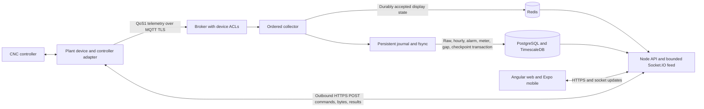

# Industrial IoT implementation audit — 13–14 October 2026

The development source has been improved across `Backend`, `pms-backend`, `FrontendIOT` and `MobileApp`. The implementation keeps the modular API, ordered collector, PostgreSQL/TimescaleDB, Redis, Socket.IO, Angular and Expo. It adds durable machine commands, stronger company/plant authorization, transactional maintenance and job rules, accurate historical measurement handling, fewer unnecessary requests and recovery safeguards.

The subsequent Ubuntu log review fixed API startup compatibility with invalid legacy machine rows and moved collector transport validation ahead of runtime startup. See [server startup correction and exact deployment steps](SERVER_STARTUP_FIX_2026-10-14.md). Invalid machine rows are excluded and diagnosed without stopping valid tenants or modifying their data.

This report distinguishes source verification from deployment verification. No configured application database, customer service or physical CNC was accessed for this work. No database was dropped, telemetry retention enabled, migration applied to the configured server, or release pushed/deployed. A complete blank-database installation, physical controller integration and Android/iOS release acceptance still require the evidence listed below. Earlier October 7 reports are historical results, not new benchmarks of this release.

## Architecture decision and scaling boundary

Keep one application API and one exclusively owning collector initially. Company and plant are authorization boundaries; machines belong to their company, plant and line. Shared company shifts remain selectable by plant users. Company-wide users have a NULL plant; a plant-bound user cannot access unplaced or another plant's machines. SQL predicates, ownership checks, cache keys and socket subscriptions use the trusted server scope rather than a caller-supplied filter.



Redis is a disposable presentation cache, not the authoritative production ledger. Program command state and file references live in PostgreSQL; files and device progress require persistent disk. MQTT uplink cannot deliver a command to a publish-only device. Outbound device POST requests solve that requirement without another broker or inbound device port. Program Transfer never starts a machining cycle.

Increasing CPU, RAM and SSD resources is the first scaling step. Separate the database from API/report work when measurements show contention. Before adding API replicas, implement shared program storage, a shared socket adapter and cross-instance socket teardown. Before adding collectors, partition ownership and add leases/fencing; two wildcard collectors processing the same machines are unsupported. The present revocation teardown applies to the running API's sockets; each HTTP request and new socket handshake checks the authoritative database revision.

Live routing loads authoritative machine placement before the API listener opens, then refreshes it after application placement/status/create/delete mutations. It suspends the affected route until concurrent mutations settle and the final database row is read. Relay overwrites stale collector plant metadata, rejects inactive/unknown/company-mismatched machines and uses plant-specific bounded machine rooms. There is no per-reading SQL/Redis lookup. Direct SQL placement edits and multiple API processes require a shared invalidation protocol; for this single-process release use the application administration API and restart after out-of-band changes. A failed placement refresh leaves that machine's route closed until a successful edit or restart.

## Phase results

| Phase | Issues found | Implemented changes and evidence | Remaining limits |
| --- | --- | --- | --- |
| 1. Inspection | Destructive reset migration; ack/live state before durable telemetry; incomplete plant filtering; concurrency races; repeated metadata calls; uploaded files confused with controller delivery | Inspected API module families, original migrations/rollbacks, collector runtime, Angular routes/services and eight mobile screens. Removed the retired reset and obsolete unsafe device sample; documented the workflow contract | Core schema CREATE definitions are absent from the repository; target schema/version/index evidence was not supplied |
| 2. Decisions | A complete rewrite would add migration and operating risk without a measured advantage | Retained the working stack and online-first architecture. Added explicit ownership and durable command boundaries without new microservices or animation libraries | Server size is workload-dependent; no unlimited-machine guarantee |
| 3. Database | Cross-company program references, duplicate active jobs/tickets, editable historical cycle baselines, unknown metrics represented as zero | Added migrations 040–045 with rollback files; composite program ownership, unique active work, cycle snapshots, gap provenance, nullable OEE and auth revisions. Disposable PG replay and constraint checks passed | Placement NOT VALID constraints preserve legacy records; mapping/validation and exact Timescale version rehearsal remain required |
| 4. API | View-only users could mutate workflows; unbounded pages/N+1 lists; stale authorization and cross-plant reads; GET changed quality history | Action-level RBAC, explicit plant-scoped reads/exports, bounded pagination, batched users/roles, atomic machine quotas/job changes, read-only quality GET, strict DB TLS and bounded pool/config. HTTP/socket scope fixtures exercise actual SQL | One indexed user lookup per authenticated request is required for immediate revision checking; benchmark it on the target database |
| 5. MQTT and PMS | Unbounded promise chains and Redis backlog; future timestamps and offline runtime inflation; alarms/meters lost; duplicate recurring work | QoS1 acknowledgement follows journal fsync; bounded parser/admission; persistent state/dedup; atomic secondary records/checkpoints; unallocated offline gaps; recurring PM locking, overrides, histories and validation | QoS0 publishers lack replay guarantees; per-message fsync is a measured throughput boundary; real broker ACL/TLS configuration remains an operator step |
| 6. Web and mobile | Duplicate masters, stale filter responses, repeated chart reloads, clumsy transfer flow and unsaved path use | Shared bounded master cache, cancellation/debounce, lazy history, slower independent chart refresh, strict plant forms, simple Upload/Backup actions, responsive controls, visible errors, reduced-motion/foreground animation handling | Complete physical-device/accessibility acceptance and native release builds remain necessary; native push registration/delivery is not implemented |
| 7. Integration | A stored file did not prove controller delivery; retries could repeat writes; backup downloaded old bytes | Idempotent durable SEND/BACKUP commands and POST-only reference agent; verified read-back; original-program backup before explicit replacement; durable retry/reconciliation; fresh running-program read per Backup click. Browser, Python and actual PG fixtures passed | The folder adapter is a test fixture. Actual Fanuc/Mitsubishi/Siemens controller adapters and operational write checks must be supplied and tested |
| 8. Performance/security | Vulnerable mail/XLSX dependencies, unnecessary requests and unsafe cache scope | ExcelJS/Nodemailer/Jest upgrades, compatible Expo patches, audited scoped overrides, tenant/plant cache isolation, request-count tests and durable-admission benchmark | Mobile has two unpatched upstream tooling advisories; no target-host latency, stress or sustained-capacity claim |
| 9. Readiness | Unsafe restore/reset procedures and undocumented schema/retention/rollback assumptions | Read-only schema capture tool; locked transactional migration ledger; checksum/off-host backup publication; restore only into a new scratch database; deployment and recovery runbook | Matching-version full restore, production schema preflight, WAL/PITR if required, retention approval and hardware/controller/native acceptance remain release gates |

## Program Transfer: operator and device contract

1. Select the machine on Program Transfer, save its IP and controller program folder, and configure its device token. Generic machine registration no longer edits transfer IP/path.
2. Upload a local program. The server saves an immutable reference and creates one SEND command in the same transaction. The screen separately shows “saved on server” and controller verification status.
3. The device calls `POST /api/device/v1/commands/next`. Repeated requests resume the same delivered command. It downloads bytes through `POST /jobs/:id/file`, verifies the checksum, validates controller safety/path, writes and reads back the controller file.
4. DONE requires `verified: true`, the expected SHA-256 and whether an existing program was replaced. Replacement requires explicit operator authorization and a previously saved backup. Uncertain writes are reconciled before another write.
5. Backup creates a new command on each click. The adapter asks the controller which program is currently selected/running, reads its actual bytes and posts a new backup. Downloading a saved backup is a separate action.
6. The UI displays specific path, unsupported-controller, unavailable-device, write/read-back and timeout errors. A failed device transfer retains the uploaded server reference.

Idempotency keys deduplicate retries; they do not deduplicate different Backup clicks. Only one new controller operation can be open per machine. Devices need unique credentials and outbound HTTPS access. Telemetry continues over MQTT. Legacy APIs remain for existing integrations and enforce scope; the new screen uses protocol 2. No Postman collection/environment files remain. See the [complete API guide](PROGRAM_TRANSFER_DEVICE_API.md).

## Database and operational changes

| Migration | Purpose | Safety behavior |
| --- | --- | --- |
| 040 | Command protocol, SEND/BACKUP lifecycle, request keys, device deadlines | Rollback refuses to discard captured protocol 2 command history |
| 041 | Company/machine composite ownership for files, devices, jobs and current pointers | Existing invalid references cause validation failure; no automatic deletion |
| 042 | Job cycle snapshots, unique active jobs/live PM tickets, placement relationships | Duplicate preflight aborts; legacy placement remains for explicit repair |
| 043 | Missing-observation provenance for unallocated parts/energy | Gaps commit with raw data/checkpoint; no guessed shift allocation |
| 044 | Nullable unknown metrics, existing shift-summary ownership from its referenced machine, company/date index | Measured values preserved; orphan/unowned rows stay for review; no cycle backfill from current components |
| 045 | Exact BIGINT authorization revision | Existing tokens are revision 0 until authorization/password changes; stale revisions must refresh |

Migration 039 and earlier ingestion/schema migrations are prerequisites. The migration runner excludes deleted003, holds a checked-out advisory lock, records transactional DDL and its checksum ledger atomically, detects checksum drift and validates arguments before loading DB configuration. `--status`/`--dry` do not create a ledger. Baselining requires an explicit last verified filename.

Historical quality uses observed job snapshots and the actual shift window, including partial first-hour buckets. Ambiguous or missing cycle baselines remain NULL. Cumulative shift rejects are not copied into every hourly bucket; hourly quality/OEE is unknown when rejects cannot be attributed to that hour. Unknown values render as gaps/dashes. Historical missing baselines are not invented. Quality saves lock the authorized machine through commit; concurrent first saves produce one total. Legacy duplicate totals return 409 for explicit review without deleting history. Dates must be valid calendar dates.

Source predicates and composite constraints improve isolation; this audit does not claim target RLS is enabled or that every table has a validated RLS policy. Table owners and BYPASSRLS roles need separate evaluation when introducing RLS. [PostgreSQL row-security documentation](https://www.postgresql.org/docs/current/ddl-rowsecurity.html).

Compression policy already exists in migration 037. Raw retention deletion was deliberately not activated without verified recovery, agreed retention and installed-extension evidence. A proposed policy is 30 days raw, compression after 7 days and 24 months hourly summaries, subject to operational/audit requirements. Verify the exact supported Timescale API and retain/reconcile alarms, meters and gaps appropriately before enabling deletion.

## Measured results

| Check | Earlier behavior/reference | Verified result and scope |
| --- | --- | --- |
| Master requests | Four concurrent consumers fetched the same metadata four times | One request in cache/coalescing fixture: 75% fewer; TTL, failure retry, write/session/grant invalidation covered |
| Mobile detail refresh | 9 scheduled detail/chart requests per minute | 6 per minute: about 33% fewer; slow requests coalesced and old responses cancelled |
| Program idle requests | Repeated machine/status/history requests in previous screen | One initial list and one compact status; no idle polling; history only when expanded. Active commands poll every 5s; stale foreground recovery makes one status request |
| Quality GET | Repeated hour queries plus summary mutation | Four bounded reads after ownership checking; historical rows reused; no GET writes |
| Redis per reading | Two awaited reads in earlier ingestion | Zero steady-state Redis reads; Redis outage does not block durable admission |
| Installed web dependencies | Three unused chart packages; 1,168 lock entries | 42 packages removed; 1,126 entries. About 85MiB unused Highcharts directory removed; it was not imported, so this is not an initial-bundle saving |
| Durable admission | No comparable safe pre-fsync benchmark | 10,000 messages/1,000 machine states, 29.7s, 336 admissions/s; p50 2.992ms, p95 4.312ms, event-loop p99 12.41ms, 15.51MiB pending journal, zero refusals on local APFS |

The admission benchmark is the real message processor plus per-message fsync with Redis unavailable and DB writes waiting. It is not end-to-end MQTT/cloud/database throughput. It does **not** demonstrate 1,000 machines at 1Hz. Net RSS change is not a peak-memory measurement. Host/cache load changed repeat results; no before/after throughput improvement is asserted for the stronger durability requirement.

Final suite counts and production bundle sizes are recorded in the verification section below. Angular keeps route lazy loading and the existing per-machine live dashboard. Budget warnings are visible; budgets were not raised to hide them. No native installed size or startup speed is inferred from a TypeScript check.

## Cost plan with explicit assumptions

Planning examples use AWS Mumbai, Linux Lightsail with public IPv4, approximately 730 hours/month, online-only clients, one collector owner, no automatic HA, encrypted off-host backups and a static web CDN. USD, before tax, overage, domain, SMS/email, operator effort and controller licensing. Illustrative retention is 30 days raw/7-day compression/24-month summaries; it is not activated.

| Candidate workload | Host layout | Monthly planning subtotal |
| --- | --- | --- |
| 30 machines at 1Hz, pilot |16GB/4vCPU/320GB host:$84;100GB snapshot:$5;250GB object bundle:$5;CDN:$2.50 |$96.50 |
| 100 machines at 1Hz, staged capacity test |32GB/8vCPU/640GB host:$164;200GB snapshot:$10;object:$5;CDN:$2.50 |$181.50 |
| 1,000 machines at0.1Hz, separate workloads |8GB API:$44;32GB DB:$164;16GB collector/broker:$84;400GB snapshots:$20;object:$5;CDN:$2.50 |$319.50 |

These are candidate budgets, not validated capacity tiers. Snapshot storage is actual billed data. Extra block storage is$0.10/GB-month; a load balancer is$18/month. Mumbai includes half the general listed transfer allowance. Verify quotas, transfer destinations and actual backup growth before ordering. [AWS Lightsail pricing, checked 14 October 2026](https://aws.amazon.com/lightsail/pricing/).

At 1Hz, 100 machines generate 259.2 million readings in 30 days. An **unmeasured sizing assumption** of 500 bytes/reading is 129.6GB before indexes, WAL, duplicate raw signals, compression, backups and free-space headroom; 1,000 machines is 1.296TB. Measure actual compressed chunk sizes before promising storage costs. Sampling intervals materially change cost. A 1,000-machine 1Hz deployment exceeds the demonstrated admission rate and needs target-disk testing and a deliberately partitioned collector design.

Nightly backups imply up to 24h recovery point. A tighter requirement needs WAL/PITR and rehearsal. An independent standby/database replica, redundant API/broker and shared storage add cost and operating work; simply buying a second host is not a verified failover system. Define RPO/RTO and availability requirements before choosing an HA bill. Protect backups and restore capability at every tier.

## Executed verification and reproduction

All tests below use fixtures or newly created local services. PostgreSQL fixtures use temporary Unix-socket-only clusters and are removed afterward; they are not a full production schema or Timescale compatibility rehearsal. Browser API/socket fixtures prevent external application traffic. Python tests use mocked controller adapters and local folders.

- Backend final integrated Jest after the server startup patch: 90 suites / 1,764 tests passed. The earlier dependency/coverage run passed 85 suites / 1,696 tests with real coverage instrumentation; it is a separate earlier run, not the final suite count.
- Collector after the startup, lag-recovery and text-contract corrections: 20 suites / 363 tests passed, including disposable Mosquitto acknowledgement/replay, configuration/entry checks, per-machine recovery, safe alarm text/lifecycle, quarantine inspection and checkpoint failure protection. Recovery requires a new on-time reading; silence cannot imply recovery. The reconnect fixture installs admission before CONNACK/PUBLISH can arrive in the same read. Real PostgreSQL VARCHAR(50) lifecycle verification passed. See [telemetry warnings](../../pms-backend/deploy/TELEMETRY_WARNINGS.md) and [quarantine text correction](../../pms-backend/deploy/QUARANTINE_TEXT_FIX.md). Already quarantined historical records still require controlled review/recovery; the patch does not automatically replay them.
- Program Transfer browser: 18 tests passed, including permissions, retries, current backup, errors, stale response cancellation, local freshness and 360/390/768/1440 layouts.
- Device reference agent: 24 Python tests passed, covering lost replies, safety, replacement backup, checksum/read-back, POST-only transport, TLS/redirect protection and fixture path escape rejection.
- Actual PostgreSQL program/measurement fixture passed migration replay, composite ownership, concurrent commands, idempotency, rollback bytes, fresh backups, error deadlines, historical cycle weighting and partial shift buckets.
- Actual PostgreSQL ingestion fixture passed raw/hourly/alarm/meter/checkpoint consistency through Redis/DB failure and lost COMMIT, migration043 replay, gap ownership and narrow collector grants.
- Actual PostgreSQL PMS fixture passed migration replay/rollback, duplicate preflight without deletion, placement constraints, concurrent quotas, atomic shift links and plant-scoped workflows.
- Final actual PostgreSQL/HTTP/Socket plant fixture passed fleet/detail/analytics/export/dropdown scope, shared shifts and assignees, legacy transfer company-action checks, concurrent quality writes and live routing after a machine move. Unknown/inactive/mismatched updates are dropped and stale collector plant metadata cannot choose recipients.
- Actual PostgreSQL/HTTP/Socket authorization fixture passed migration 045 replay/rollback, exact BIGINT revision comparison, role/company/user scope changes, old-token rejection, registered-socket teardown, handshake-race closure, transaction rollback and Redis failure independence. Focused revocation tests 212 passed before the full suite.
- Angular final unit suite: 32 files / 256 tests passed. Production build passed: initial assets 521.67kB/estimated transfer 125.54kB; lazy Program Transfer 43.49kB/10.13kB. Warnings remain for initial 500kB, Program Transfer CSS 4.36kB and maintenance CSS 7.86kB; error budgets were met and were not increased.
- Mobile final typecheck and 24 request/realtime lifecycle tests passed; the Expo compatibility check passed. Current authorization is persisted and applied to screen/session state; scope changes cancel old requests and remount screens. These checks are not signed native builds or physical-device startup measurements.
- Backend runtime and full dependency audits: 0 advisories. Web/collector audits also returned 0. Mobile has 15 high package-chain entries from two unpatched tooling source advisories; details and executed audit scope are in [DEPENDENCY_SECURITY.md](DEPENDENCY_SECURITY.md).

Backup script simulation also passed: dump/checksum remain private, S3 prefix normalization prevents a manifest overwriting its dump, and failed dump/off-host upload preserves older recovery artifacts. Restore-target refusal and shell syntax checks passed. These simulations do not constitute a full database restore.

Reproduce from the respective repository with Node22:

```sh
# Backend: isolated API/unit checks (temporary listener permission required)
node node_modules/jest/bin/jest.js --runInBand
node tools/architecture/verify-program-commands.cjs
node tools/architecture/verify-pms-integrity.cjs
node tools/architecture/verify-plant-read-isolation.cjs
node tools/architecture/verify-auth-revocation.cjs
python3 -m unittest discover -s tools/program-agent/tests -v
bash -n scripts/ops/db-backup.sh scripts/ops/db-restore-test.sh

# pms-backend: no application .env services used by fixtures
node --experimental-vm-modules node_modules/jest/bin/jest.js --runInBand
node tools/verify-ingestion.mjs
node tools/benchmark-admission.mjs 10000 1000

# FrontendIOT
node node_modules/@angular/cli/bin/ng.js test --watch=false
node node_modules/@angular/cli/bin/ng.js build --configuration production
node node_modules/@playwright/test/cli.js test --config=playwright.program-transfer.config.ts

# MobileApp
node node_modules/typescript/bin/tsc --noEmit
node --test tests/realtime.test.cjs tests/request-lifecycle.test.cjs
EXPO_OFFLINE=1 node node_modules/expo/bin/cli install --check
```

Schema capture requires explicitly supplied `SCHEMA_AUDIT_URL` and never loads application `.env`. Keep that report and credentials private. Migration status/deploy commands are in [the deployment and recovery runbook](../../LOCAL_DEPLOYMENT_RUNBOOK.md), not part of the isolated test command block.

## Local file storage, 14 October 2026

New application uploads no longer require S3. `STORAGE_ROOT` contains company folders with `images/machines` and `programs/machine-ID/{uploads,backups,fetched}`. New paths use immutable company/machine IDs; old program database references keep reading their original legacy root. The AWS SDK dependency and its 102-package dependency subtree were removed without adding another storage/image package.

Migration 046 adds tenant/plant-owned image metadata and retains company ownership if an empty plant is deleted. Uploads are limited to signature-checked JPEG/PNG/WebP images of 5 MB, with immutable UUID files and failed-insert cleanup. Image reads and machine image assignments enforce company, current plant and page/company grants. The frontend uses authenticated blob requests, shared bounded unused-image caching, viewport deferral, upload/save coordination and session/revision invalidation. Existing remote images remain readable without forwarding credentials.

Final local verification: backend **94 suites / 1,899 tests**, frontend **35 files / 273 tests**, two isolated Chromium upload/display/cache/mobile-layout checks, and the production build passed. Initial web assets are 523.20 kB / estimated transfer 125.71 kB; the existing 500 kB initial warning and two existing style warnings remain. Disposable PostgreSQL media and command fixtures passed catalogue constraints, repeatable migration, nonempty rollback refusal, immutable files, current plant routing, deleted-plant access and failed-insert compensation. Fixtures do not use application `.env` services.

Reproduce the additional PostgreSQL check with `node tools/architecture/verify-local-media.cjs`, and the browser fixture with `node node_modules/@playwright/test/cli.js test --config=playwright.local-storage.config.ts` in their respective repositories. These fixtures require permission for temporary local listeners/Unix sockets. See [local file deployment](LOCAL_FILE_STORAGE.md) for persistent volume setup and recovery.

Existing S3 bytes were not fetched, moved or deleted. Re-upload/import and verify them before a disconnected on-prem move. Back up the database, unified file root, legacy program root and collector journal together; the database-only backup script's optional S3 off-host copy is independent of application uploads. No deployment, production schema change or push was performed for this storage change.

## Remaining release gates

1. Export and review the real core schema, PostgreSQL/Timescale versions, constraints, indexes and grants; package a verified complete base schema so a new installation is reproducible. Resolve legacy invalid placements/references and duplicate operational entries without deleting history blindly.
2. Verify a full matching-version backup restore, image/program-file recovery and journal checkpoint continuity before target migrations. Apply reviewed migrations 040–046 and all prerequisites in staging, then rehearse rollback. No such target mutation was performed here.
3. Implement/verify the actual controller adapter: selected/running-program read, path syntax, read/write support, write interlocks and safe reconciliation after interruption. The reference agent must run on the device; a server upload alone cannot place bytes in a CNC.
4. Run signed Android/iOS builds and representative low-memory physical-device/browser/tablet tests. Expo 57 targets Android 7+ and iOS 16.4+; it cannot support every historic model. Native APNs/FCM registration/delivery remains future work; the unused permission prompt was removed. [Versioned Expo 57 reference](https://docs.expo.dev/versions/v57.0.0/).
5. Recheck the two upstream mobile tooling advisories before release. Do not downgrade Expo to an incompatible SDK merely to silence npm audit.
6. Confirm actual broker device ACL/TLS enforcement, persistent QoS1 publisher behavior, target SSD throughput, sustained ingestion/query load, pool headroom, disk alerts and backup age. Agree retention and RPO/RTO before applying deletion policies or advertising an SLA.
7. Complete shared storage, shared sockets/revocation and collector fencing before horizontal replicas. Record target-host payload, p95 API/query latency, browser memory/frame time and native startup measurements; no universal “Google-quality” or complete WCAG certification is claimed by these source tests.

The source implementation and isolated verification are reviewable in this workspace. Production acceptance depends on these environment/device facts and rehearsals, not on UI appearance or a passing mock suite alone.
